# Netrunner: a hacker theme for Claude Code

**Netrunner is a dark, cyberpunk / hacker theme for the Claude Code client** (the Claude desktop app's Code tab and the `claude` terminal) on **Windows, macOS and Linux**. It gives Claude Code the whole app's colors with a slow network-map background, a status band above the prompt, animated hacker crabs for your subagents, a WAITING line so you can see when a session is still working, funny hacker spinner words, and four color variants.



## Color variants

| Packet Trace | Zero Day |
| --- | --- |
|  |  |
| Graphite, phosphor teal, violet highlights | Terminal green on near-black, magenta highlights |

| Cold Boot | Black ICE |
| --- | --- |
|  |  |
| Steel, ice cyan, periwinkle highlights | Plum black, hot magenta, electric purple |

## What you get

- **App look and background**: in the desktop app, the variant colors the whole window (page, cards, panels, menus, text and code highlighting) and draws a sparse network map behind the conversation, with packets drifting along its links and a node that pings. It moves on slow 12 to 70 second loops, stays in the corners away from the words, and holds still if your system asks for reduced motion or you set `look` to `still`.
- **Status band above the prompt**: how much of your 7-day and 5-hour usage is used (amber at 60%, red with HIGH at 85%), and the prompt cache: **WARM** for an hour after the last request, then **COLD** with what the next message costs to re-cache. **Show** opens a card with the details.
- **WAITING line**: when a turn ends with work still running (a background command, a background agent, a monitor, a workflow or a scheduled wake-up), the band says what the session is waiting on and for how long, so a session that is waiting no longer looks finished.
- **Sweep**: a light runs along the band whenever anything in the session is running (a turn, waiting work or subagents) and stops when nothing is.
- **Hacker crabs** (`netrunner-crew`): running subagents show as walking crabs in hacker outfits with a count and their task, on one compact line that joins the WAITING line. `×N` or `/crew` opens the full agents panel; no window pops up on its own.
- **Transcript skins**: four matching skins for the [skins](https://github.com/hellosverre/claude-skins) mod: tool rows colored by kind (Read, Edit, Bash, Grep, web, MCP), amber and red kept for interrupted and failed calls only, and spinner words like *Hacking the mainframe*, *Downloading more RAM* and *Blaming DNS*, then *Pwned*, *Rooted* or *Exfiltrated* when done.
- **Zero tokens**: everything is drawn from figures Claude Code already has. Nothing calls the model.

## Install

At the prompt of a Claude Code terminal session (`claude`):

```
/plugin install skins --marketplace hellosverre/claude-skins
/plugin install netrunner --marketplace Err0ric/netrunner
/plugin install netrunner-crew --marketplace Err0ric/netrunner
```

Answer `y` to add each marketplace, then pick the user scope. From a shell, the same with `claude plugin install <plugin> --marketplace <owner>/<repo>`.

In the Claude desktop app, where `/plugin` does not run: click **+** next to the prompt box, then **Plugins**, **Add marketplace** with `Err0ric/netrunner`, then **Add plugin** for `netrunner` and `netrunner-crew` (and the same with `hellosverre/claude-skins` for `skins`). Plugins installed from a terminal at the user scope load in the desktop app too.

`skins` colors the transcript; without it Netrunner still draws the band and tells you once that the skins are missing. `netrunner-crew` is optional: without it there are no crabs.

On the first start, Netrunner saves its four skins into the skins mod (`netrunner-packet-trace`, `netrunner-zero-day`, `netrunner-cold-boot`, `netrunner-black-ice`) and switches to the variant you chose.

## Settings

In a terminal session, open `/config` and find **Netrunner**:

| Option | Values | Default |
| --- | --- | --- |
| `variant` | `packet-trace`, `zero-day`, `cold-boot`, `black-ice` | `packet-trace` |
| `look` | `animated`: the variant's colors for the whole app and the moving network map. `still`: the same, held still. `off`: keep the app's own colors and background | `animated` |
| `skin` | `apply` switches the transcript skin when you pick a variant; `keep` saves the skins but leaves yours alone | `apply` |

Or in `~/.claude/settings.json` (Windows: `%USERPROFILE%\.claude\settings.json`):

```json
{ "pluginConfigs": { "netrunner@netrunner": { "options": { "variant": "zero-day", "look": "still" } } } }
```

`netrunner-crew` has `autoOpen` (`off` by default: the panel opens only from `×N` or `/crew`; `savvy` or `any` open it by itself), `finished` (`show` or `hide` finished agents) and `language` (`auto`, `en`, `ru`, `he`).

To switch skins by hand: `/skin netrunner-black-ice` (or any other).

### Matching file tree colors (optional)

If you use the [filetree](https://github.com/data-goblin/claude-code-filetree) mod, set its `palette` option to the line for your variant:

| Variant | filetree `palette` |
| --- | --- |
| Packet Trace | `fg=#dae7e4 bg=#0b0f12 accent=#3ddcb4 muted=#869a96 urgent=#ff5c6c selection=#16302b hover=#131d22 jump=#9d8cff added=#9bd86a modified=#6cb8d6 renamed=#9d8cff add=#9bd86a del=#ff5c6c` |
| Zero Day | `fg=#c8d3cc bg=#0b100d accent=#4af58a muted=#7a958a urgent=#ff3b5c selection=#173322 hover=#121a15 jump=#d77bff added=#7ee787 modified=#5ccfe6 renamed=#d77bff add=#7ee787 del=#ff3b5c` |
| Cold Boot | `fg=#dce6f0 bg=#0a0f16 accent=#67e8f9 muted=#8394a8 urgent=#fb7185 selection=#16303a hover=#121a24 jump=#a5b4fc added=#86efac modified=#93c5fd renamed=#a5b4fc add=#86efac del=#fb7185` |
| Black ICE | `fg=#ecdff0 bg=#0d0811 accent=#ff3ea5 muted=#9a8aa6 urgent=#ff5c5c selection=#3a1530 hover=#1c1424 jump=#00e5ff added=#9bd86a modified=#b26bff renamed=#00e5ff add=#9bd86a del=#ff5c5c` |

## Platforms

Netrunner is a Claude Code mod: it runs inside Claude Code's own engine and reaches nothing outside it except through Claude Code, so the same files run on **Windows, macOS and Linux**, in the **desktop app** (animated drawings) and the **terminal** (a text version of the band). The app look and background draw in the desktop and mobile apps; a terminal keeps its own background, so set that in your terminal app. Only one mod can set the app's look at a time: if you use another theme mod, set `look` to `off` here or turn the other one off. Animations stop when your system asks for reduced motion.

## Credits

- Usage bars based on [robonuggets/ribbon](https://github.com/robonuggets/ribbon) (MIT).
- `netrunner-crew` is a fork of savvy-progress from [johnnyvizz/claude-kit](https://github.com/johnnyvizz/claude-kit) (MIT): its agents panel and crab drawings, with a compact crew row and the panel kept shut by default.
- Transcript skins drawn by [skins](https://github.com/hellosverre/claude-skins) (MIT).

See [NOTICE.md](NOTICE.md). Not affiliated with Anthropic.

## License

[MIT](LICENSE)

---

*Keywords: Claude Code theme, Claude Code themes, Claude Code skin, Claude Code dark theme, Claude Code background, Claude desktop app background, Claude Code animated background, Claude Code hacker theme, Claude Code cyberpunk theme, Claude Code status line, Claude Code usage meter, Claude Code prompt cache, Claude Code subagents, Claude Code plugin, Claude Code mod, Claude desktop app theme, Claude Code terminal theme, Windows, macOS, Linux.*
