# Netrunner: a cyber theme for Claude Code

**Netrunner is a dark cyber theme for the Claude Code client** (the Claude desktop app's Code tab and the `claude` terminal) on **Windows, macOS and Linux**. It gives Claude Code the whole app's colors with a slow network-map background, a status band above the prompt, animated hacker crabs for your subagents, a WAITING line so you can see when a session is still working, and five color variants.



*The Claude Code desktop app with Netrunner, cycling through all five variants. The conversation is a made-up example.*

## Color variants

| Variant | Look |
| --- | --- |
| **Packet Trace** (default) | Graphite, phosphor teal, violet highlights |
| **Zero Day** | Terminal green on near-black, magenta highlights |
| **Cold Boot** | Steel, ice cyan, periwinkle highlights |
| **Black ICE** | Black and white; color only for errors, warnings and success |
| **Red Team** | Red-black, deep crimson, ember highlights |

Switch with the dots on the open cache card in the desktop app, or with the `variant` option (see Settings). Before 1.6.0, Black ICE was the crimson palette, which is now Red Team.

## What you get

- **App look and background**: in the desktop app, the variant colors the whole window (page, cards, panels, menus, text and code highlighting) and draws a sparse network map behind the conversation, with packets drifting along its links and a node that pings. It moves on slow 12 to 70 second loops, stays in the corners away from the words, and holds still (the map stays, the moving packets are left out) if your system asks for reduced motion or you set `look` to `still`.
- **Status band above the prompt**: how much of your 7-day and 5-hour usage is used (amber at 60%, red with HIGH at 85%), and the prompt cache: **WARM** for an hour after the last request, then **COLD** with what the next message costs to re-cache. **Show** (▲) opens a card with the details. While it is open, five small dots beside its ▼ switch the variant in one click (the ringed dot is the current one).
- **WAITING line**: when a turn ends with work still running (a background command, a background agent, a monitor, a workflow or a scheduled wake-up), the band says what the session is waiting on and for how long, so a session that is waiting no longer looks finished.
- **Sweep**: a light runs along the band whenever anything in the session is running (a turn, waiting work or subagents) and stops when nothing is.
- **Hacker crabs** (`netrunner-crew`): running subagents show as walking crabs in hacker outfits with a count and their task, on one compact line that joins the WAITING line. `×N` or `/crew` opens the full agents panel; no window pops up on its own.
- **Transcript skins**: five matching skins for the [skins](https://github.com/hellosverre/claude-skins) mod: tool rows colored by kind (Read, Edit, Bash, Grep, web, MCP), amber and red kept for interrupted and failed calls only, and spinner words like *Hacking the mainframe*, *Downloading more RAM* and *Blaming DNS*, then *Pwned*, *Rooted* or *Exfiltrated* when done.
- **Zero tokens**: everything is drawn from figures Claude Code already has. Nothing calls the model.

## Install

One install brings everything: `netrunner` pulls in `netrunner-crew` (the crabs), [skins](https://github.com/hellosverre/claude-skins) by hellosverre (the transcript skins) and [filetree](https://github.com/data-goblin/claude-code-filetree) by data-goblin (the file tree, in matching colors). Both are MIT and listed in this marketplace from their own repositories, pinned to the commits Netrunner is tested with.

From a shell:

```
claude plugin marketplace add Err0ric/netrunner
claude plugin install netrunner@netrunner
```

Or at the prompt of a Claude Code terminal session (`claude`): `/plugin install netrunner --marketplace Err0ric/netrunner`, answer `y` to add the marketplace, then pick the user scope.

In the Claude desktop app, where `/plugin` does not run: click **+** next to the prompt box, then **Plugins**, **Add marketplace** with `Err0ric/netrunner`, then **Add plugin** for `netrunner`. Plugins installed from a terminal at the user scope load in the desktop app too.

filetree's sidebar needs the fullscreen layout in a terminal (`/tui fullscreen`, at least 110 columns); the desktop app docks it by itself. `/filetree` opens or closes it.

### Already have skins or filetree?

If you installed `skins` from `hellosverre/claude-skins` or `filetree` from `data-goblin/claude-code-filetree` before, switch to the copies listed here, or you end up with two of each.

1. Note the filetree options you changed in `/config` (Open at start, Palette and so on): uninstalling removes them.
2. Remove the old copies, then bring in the ones listed here. Updating `netrunner` does not install a plugin that is missing, so install them by name; `netrunner` does not load until `skins` is there:

```
claude plugin uninstall skins@hellosverre-mods
claude plugin uninstall filetree@claude-code-filetree
claude plugin marketplace update netrunner
claude plugin update netrunner@netrunner
claude plugin install skins@netrunner
claude plugin install filetree@netrunner
```

3. Run `/reload-plugins` or start a new session. On that start Netrunner sees the new skins copy has none of its skins, saves the five again and switches to your variant's skin.

Each plugin keeps its settings and saved data under its full name (`skins@netrunner` is not `skins@hellosverre-mods`), so the new copies start fresh: set filetree's options again, and any skins of your own and your skins settings (rail, icons, tables and so on) need making or setting again too.

On the first start, Netrunner saves its five skins into the skins mod (`netrunner-packet-trace`, `netrunner-zero-day`, `netrunner-cold-boot`, `netrunner-black-ice`, `netrunner-red-team`) and switches to the variant you chose.

## Update

From a shell, refresh the marketplace, then update the plugins:

```
claude plugin marketplace update netrunner
claude plugin update netrunner@netrunner
claude plugin update netrunner-crew@netrunner
claude plugin update skins@netrunner
claude plugin update filetree@netrunner
```

An update does not install a plugin that is missing: if `claude plugin list` shows `netrunner` failing to load for a missing one, install it by name (`claude plugin install skins@netrunner`).

Then run `/reload-plugins` in an open session, or start a new one.

## Settings

In a terminal session, open `/config` and find **Netrunner**:

| Option | Values | Default |
| --- | --- | --- |
| `variant` | `packet-trace`, `zero-day`, `cold-boot`, `black-ice`, `red-team` (in the desktop app, also the dots on the open cache card) | `packet-trace` |
| `look` | `animated`: the variant's colors for the whole app and the moving network map. `still`: the same map, held still, without the moving packets. `off`: keep the app's own colors and background | `animated` |
| `skin` | `apply` switches the transcript skin when you pick a variant; `keep` saves the skins but leaves yours alone | `apply` |
| `filetree` | `match` sets the [filetree](https://github.com/data-goblin/claude-code-filetree) mod's palette to the variant's colors (a palette you wrote yourself is left alone); `off` never touches filetree | `match` |

Or in `~/.claude/settings.json` (Windows: `%USERPROFILE%\.claude\settings.json`):

```json
{ "pluginConfigs": { "netrunner@netrunner": { "options": { "variant": "zero-day", "look": "still" } } } }
```

`netrunner-crew` has `autoOpen` (`off` by default: the panel opens only from `×N` or `/crew`; `savvy` or `any` open it by itself), `finished` (`show` or `hide` finished agents) and `language` (`auto`, `en`, `ru`, `he`).

To switch skins by hand: `/skin netrunner-black-ice` (or any other).

### Matching file tree colors

If you use the [filetree](https://github.com/data-goblin/claude-code-filetree) mod, Netrunner sets its `palette` option to your variant's line at each start, so folders and git colors follow when you switch variants. It only writes over an empty palette, one of the lines below, or the pink Black ICE line from before 1.3.0: a palette of your own stays as it is. Set Netrunner's `filetree` option to `off` to stop it.

To set one by hand instead, these are the lines:

| Variant | filetree `palette` |
| --- | --- |
| Packet Trace | `fg=#dae7e4 bg=#0b0f12 accent=#3ddcb4 muted=#869a96 urgent=#ff5c6c selection=#16302b hover=#131d22 jump=#9d8cff added=#9bd86a modified=#6cb8d6 renamed=#9d8cff add=#9bd86a del=#ff5c6c` |
| Zero Day | `fg=#c8d3cc bg=#0b100d accent=#4af58a muted=#7a958a urgent=#ff3b5c selection=#173322 hover=#121a15 jump=#d77bff added=#7ee787 modified=#5ccfe6 renamed=#d77bff add=#7ee787 del=#ff3b5c` |
| Cold Boot | `fg=#dce6f0 bg=#0a0f16 accent=#67e8f9 muted=#8394a8 urgent=#fb7185 selection=#16303a hover=#121a24 jump=#a5b4fc added=#86efac modified=#93c5fd renamed=#a5b4fc add=#86efac del=#fb7185` |
| Black ICE | `fg=#e8e8e8 bg=#0a0a0b accent=#f2f2f2 muted=#8c8c8c urgent=#ff5c5c selection=#2a2a2c hover=#18181a jump=#bdbdbd added=#9bd86a modified=#c8c8c8 renamed=#bdbdbd add=#9bd86a del=#ff5c5c` |
| Red Team | `fg=#f0dcdc bg=#0c0606 accent=#e0262f muted=#9a7f7f urgent=#ff4d4d selection=#3a1214 hover=#1c0d0d jump=#ff6f4d added=#9bd86a modified=#ff9a8a renamed=#ff6f4d add=#9bd86a del=#ff4d4d` |

## Platforms

Netrunner is a Claude Code mod: it runs inside Claude Code's own engine and reaches nothing outside it except through Claude Code, so the same files run on **Windows, macOS and Linux**, in the **desktop app** (animated drawings) and the **terminal** (a text version of the band). The app look and background draw in the desktop and mobile apps; a terminal keeps its own background, so set that in your terminal app. Only one mod can set the app's look at a time: if you use another theme mod, set `look` to `off` here or turn the other one off. Animations stop when your system asks for reduced motion.

## Credits

- Usage bars based on [robonuggets/ribbon](https://github.com/robonuggets/ribbon) (MIT).
- `netrunner-crew` is a fork of savvy-progress from [johnnyvizz/claude-kit](https://github.com/johnnyvizz/claude-kit) (MIT): its agents panel and crab drawings, with a compact crew row and the panel kept shut by default.
- Transcript skins drawn by [skins](https://github.com/hellosverre/claude-skins) (MIT).

See [NOTICE.md](NOTICE.md). Not affiliated with Anthropic.

## License

[MIT](LICENSE)

---

*Keywords: Claude Code theme, Claude Code themes, Claude Code skin, Claude Code dark theme, Claude Code background, Claude desktop app background, Claude Code animated background, Claude Code tech theme, Claude Code cyber theme, Claude Code status line, Claude Code usage meter, Claude Code prompt cache, Claude Code subagents, Claude Code plugin, Claude Code mod, Claude desktop app theme, Claude Code terminal theme, Windows, macOS, Linux.*
